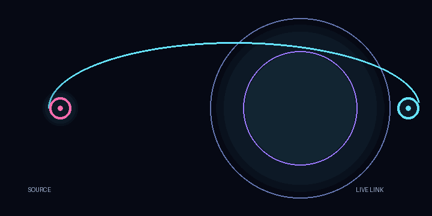

# Muse AI Repost

A static visual relay site for moving one exact post from a named source to a named destination—and keeping the live URL as the receipt.

> **Important:** This repository is a front-end concept and promo site. It does **not** connect to social platforms, read credentials, store posts, or perform reposting.

## Why this exists

Reposting can become messy when the source, destination, copy, and proof of publication are all ambiguous. This site makes the intended handoff legible: name the source and target, hold the exact copy temporarily, then verify the live link.

It is designed for a small, explicit workflow rather than a content library or bulk scheduler. The interface deliberately reinforces the boundaries in the product language: no rewriting, no unnamed destinations, no bulk actions, and no “done” state without a verified URL.

## See it work

The quickest way to try the project is to run the static site locally:

```bash
python3 -m http.server 4173
```

Then open <http://localhost:4173> and explore:

- [How it works](pages/how-it-works.html) — the three-step **Order → Hold → Verify** flow.
- [Promo kit](pages/promo-kit.html) — the included local visual assets and looping relay animation.
- [Platform rules](pages/platform-rules.html) — the operating guardrails and community links.

No live demo URL is configured in this repository. No GitHub Pages workflow is included, but the package is compatible with GitHub Pages and Cloudflare Pages because `index.html` is the entry point and no build command is required.

### Visual preview




## Quick start

### Run locally

```bash
# clone or download this repository
cd muse-ai-repost-background

# start a static server
python3 -m http.server 4173

# open http://localhost:4173
```

The site has no install step, runtime dependencies, API keys, or server-side code.

### Test the package

There is no automated test suite in this repository. A minimal smoke test is:

```bash
python3 -m http.server 4173
curl -I http://localhost:4173/
curl -I http://localhost:4173/pages/how-it-works.html
curl -I http://localhost:4173/assets/promo-hero.png
```

Each request should return `200 OK` while the server is running.

## What is included

| Path | Purpose |
| --- | --- |
| `index.html` | Animated dark signal-relay homepage with pause control. |
| `pages/how-it-works.html` | Explains the Order → Hold → Verify flow. |
| `pages/promo-kit.html` | Gallery for the included promotion graphics. |
| `pages/platform-rules.html` | Documents reposting guardrails and community channels. |
| `pages/support.html` | Age-gated support and donation area with separated payment tabs. |
| `pages/private-communities.html` | Age- and country-gated Matrix access page. |
| `assets/promo-hero.png` | Hero artwork for the relay concept. |
| `assets/banner-source-target.png` | Source-to-target relay artwork. |
| `assets/card-temp.png` | Temporary-hold card artwork. |
| `assets/card-verified.png` | Live-verification card artwork. |
| `assets/relay-loop.gif` | Local looping relay animation. |
| `script.js` | Canvas-based signal field animation and pause/resume behavior. |
| `styles.css` | Shared visual system and responsive styling. |

## Deployment

The site is plain static HTML, CSS, JavaScript, SVG, PNG, and GIF. To deploy it, upload the repository contents to a static host and use the repository root as the output directory with an empty build command. `index.html` is the entry point.

For GitHub Pages, enable Pages for the branch or directory containing these files. For Cloudflare Pages, set the build command to empty and the output directory to the project root. Those hosting targets are supported by the file layout, but deployment is not configured or verified in this repository.

## Customize

- Edit page copy directly in the HTML files.
- Tune the palette and responsive layout in `styles.css` and `pages/site-pages.css`.
- Replace the local SVG, PNG, and GIF files in `assets/`.
- Adjust the canvas animation in `script.js`.

The site respects `prefers-reduced-motion` and exposes a visible pause control for the animated field. Payment providers load only after age confirmation on the support page, and the private Matrix room remains behind age and country eligibility checks.

## License

No license file or license declaration is included in this repository. Check with the project owner before reusing the code or assets.
